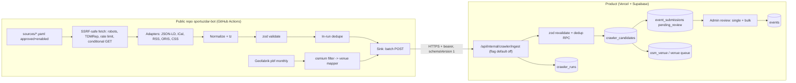

# sportuzdar-bot: design (2026-11-22)

## 1. Verdict

- **Separate repository: yes.** (1) The product repo's Actions are blocked by a personal-account billing problem. GitHub's locked-account doc says a personal billing lock can block Actions "or other free-tier access", so the bot must not share that owner. (2) Trust boundary: the bot never holds database credentials, and a separate repo enforces that by construction. (3) It has its own cadence and runner. Cost: a contract to keep in sync between the two repos (section 5).
- **Owner: a new free GitHub organization**, not the personal account. This isolates the bot from personal billing incidents, such as a failed authorization hold on a Copilot or budget change.
- **Visibility: public (recommended).** Verified facts:
  - Standard runners in public repos are free and do not draw from included usage.
  - Private repos on Free get a $12/month pool, about 2,000 Linux minutes at $0.006/min. The bot needs about 150-600 min/month.
  - Public repos have scheduled workflows auto-disabled after 60 days without repo activity. Logs must be assumed public, the source register is visible, and GitHub says self-hosted runners should almost never serve public repos.
  - Upside: the README doubles as the public crawler policy behind the user-agent contact URL.
  - Alternative: a private org repo with no payment method. Usage is then blocked, not billed, once the included compute is used. It hides the sources and avoids the 60-day rule, but it relies on a per-org quota that was not verified.
- **The real risk is the terms, not cost.** The Actions terms name "part of a serverless application" as a bad use. On GitHub-hosted runners they bar activity "unrelated to the production, testing, deployment, or publication of the software project". They also contain a "develop and test" clause. A daily feed into production sits in a grey zone. Misuse can mean job termination, a disabled repo, or rarely account action. Mitigation: keep volume low, keep the crawler code and tests as the repo's subject, keep a fallback runner ready, and use the separate org to limit the blast radius.

## 2. Hosting

| Option                                    | Cost                  | Decisive limit                                                  | Risk                                                     |
| ----------------------------------------- | --------------------- | --------------------------------------------------------------- | -------------------------------------------------------- |
| **GitHub Actions, public org repo**       | $0                    | 6 h per job; runs can be late or dropped at the top of the hour | Terms grey zone; 60-day auto-disable; public logs        |
| GitHub Actions, private org repo, no card | $0 (blocked at quota) | $12 pool ≈ 2,000 min                                            | Per-org quota unverified                                 |
| GitHub Actions, personal account          | $0-metered            | Billing lock blocks free tier too                               | Already happened                                         |
| Oracle Always Free VM, cron               | $0                    | Idle instances can be reclaimed                                 | Signup and capacity fickle                               |
| Home PC (Task Scheduler)                  | $0                    | Uptime                                                          | Not as a self-hosted runner on a public repo             |
| Supabase pg_cron + Edge Function          | $0                    | 150 s wall, 2 s CPU                                             | Puts the crawler inside the production DB trust boundary |
| Cloudflare Workers Free                   | $0                    | 10 ms CPU, 50 subrequests                                       | Usable as a trigger only                                 |
| Vercel Hobby cron                         | $0                    | 300 s; once a day ±59 min                                       | Hobby terms say non-commercial only                      |

**Choice:** GitHub Actions in a public repo owned by the new org. Cron `17 3 * * *` with the IANA timezone `Europe/Bratislava`.

**Fallback (documented, not provisioned):** the same CLI (`pnpm bot run`) under cron on an Oracle Always Free VM or the home PC. For that to work, the core engine stays runner-agnostic: one Node process, configured by env, with no Actions APIs inside the core.

## 3. Architecture



**Trust boundaries**

1. **Internet to bot.** Everything fetched is untrusted. The fetcher only contacts allowlisted hosts, blocks private and link-local IPs after DNS resolution, refuses redirects to hosts off the allowlist, and caps size and time. No headless browser and no eval.
2. **Bot to web.** The bot can only POST over HTTPS with authentication. The web app revalidates every field, so bot output is treated as untrusted input.
3. **Web to DB.** The service role is used only inside the route and writes only to staging and review tables. It never writes to `events` or `venues`; publishing stays a human action or an explicit owner-approved policy.
4. **GitHub public surface.** No `pull_request_target`. Workflows from fork PRs are disabled. Workflows default to `permissions: contents: read`, and only the health job gets `issues: write`. Actions are pinned by SHA.

**Secrets inventory**

| Secret                      | Location                                   | Purpose                                                                                                 |
| --------------------------- | ------------------------------------------ | ------------------------------------------------------------------------------------------------------- |
| `CRAWLER_INGEST_TOKEN`      | Bot Actions secret + Vercel production env | Bearer token. Rotate every 90 days; the endpoint accepts the current and the next token during rotation |
| Supabase service role       | Vercel only (already exists)               | Staging writes. Never present in the bot                                                                |
| `GITHUB_TOKEN`              | Created per run                            | Opens the health issue                                                                                  |
| (Deferred) fine-grained PAT | Cloudflare Worker secret                   | Watchdog `repository_dispatch`                                                                          |

No v1 source needs an API key.

## 4. Repository layout and tooling

```
packages/engine    fetch, politeness, robots/TDMRep, adapter interface, jsonld, ical, rss, oris
packages/contract  zod schemas v1 + golden fixtures
packages/venues    Geofabrik download, osmium filter, OSM->venue mapping, diff
apps/cli           bot run | bot venues --country SK | bot check-source <id>
sources/           one YAML per source: tier, hosts, adapter, caps, licence, terms URL+date,
                   robots/TDMRep result, approvedBy/At, enabled: false by default
.github/workflows  ci.yml, daily.yml, venues-monthly.yml, health.yml
```

- **Stack:** Node 24, pnpm with a frozen lockfile, strict TypeScript, `node:test` via tsx, zod, eslint and prettier, LF line endings. Dependencies are kept minimal (zod plus an iCal parser and an HTML parser). No Playwright.
- **Test fixtures:** synthetic only. Never commit copied third-party pages to a public repo.
- **Repo hygiene:** Dependabot for security updates, PRs required on `main`, and the portable engine lifted from the parallel slice, tests included.

## 5. Ingest contract

> **v1 wire contract (authoritative, 2026-11-25):** the shipped contract is the flat schema in `src/contract/crawler.ts`, a copy of the product's `packages/api/src/crawler.ts` (PR #165): `{ schemaVersion: 1, source: { id, name }, fetchedAt, candidates[≤200] }` with outcomes `created | duplicate | rejected`. The `run` / `items` / `fields` envelope and the richer outcomes below are the **v2 target** (ledger + update tracking) and are not implemented yet.

```json
{
  "schemaVersion": 1,
  "run": {
    "runId": "gh-000000-1",
    "botVersion": "0.1.0",
    "startedAt": "2026-12-01T03:17:04+01:00",
    "trigger": "schedule"
  },
  "items": [
    {
      "kind": "event",
      "sourceId": "oris",
      "externalKey": "oris:event:0000",
      "contentHash": "sha256:…",
      "fetchedAt": "2026-12-01T03:18:11+01:00",
      "licenceTier": "green",
      "fields": {
        "title": "Example sprint race",
        "start_date": "2027-05-15T10:00:00+02:00",
        "time_known": true,
        "city": "Olomouc",
        "country_code": "CZ",
        "sport_type": "other",
        "event_type": "race",
        "organizer_name": "Example club",
        "latitude": 49.59,
        "longitude": 17.25,
        "event_url": "https://example.org/event/0000",
        "distances": []
      },
      "provenance": {
        "sourceUrl": "https://example.org/api/event/0000",
        "adapter": "oris@1",
        "robots": "override:owner-YYYY-MM-DD",
        "tdmrep": "none"
      }
    }
  ]
}
```

- **Field rules:** the `fields` keys mirror `event_submissions`. The server sets `slug`, `id`, `status`, `source` and `user_id`.
- **Response:** per item, one of `created | updated | unchanged | skipped_duplicate | rejected(reason)`.
- **Status codes:** 404 when the flag is off, 401 for a bad token, 413 for more than 100 items, 422 for an unknown schemaVersion.

**Idempotency**

- The key is `(sourceId, externalKey)`. `externalKey` is the source's own stable id (ORIS id, JSON-LD `@id`, iCal UID). Where none exists, it is sha256 of the canonical `event_url` plus the local start date.
- If `contentHash` is unchanged, the item is `unchanged`.
- Updates apply only while a candidate is still pending. Changes to an item that is already published are flagged for the admin and never overwrite a live event.
- Replaying a batch is harmless.

**Repository facts that decide the staging question**

- There is no unique constraint on `source_url`, `event_url` or `import_url`.
- `user_id` is NOT NULL and references `profiles`, which references `auth.users`.
- `submitForReview` is owner-only, so the endpoint must insert directly as `pending_review`.
- `publishSubmission` hard-codes `source='user_submission'` and drops provenance.
- There is no bulk approve, no venue writer and no venue queue. `events` has no `venue_id`.

**Recommendation: two steps.**

- **v1 (in flight, no migration).** Write to `event_submissions` as `pending_review` under a bot profile. Idempotency is an app-side lookup on (bot `user_id`, `extraction_meta.bot.sourceId`, `externalKey`). That is acceptable only because a single sequential daily run writes, limited to green sources and about 200 items/day.
- **v2 (migration, owner GO).**
  - Add a `crawler_candidates` ledger: kind, `source_id`, `external_key`, `content_hash`, payload, `first_seen`/`last_seen`, status, dedup, `submission_id`, with UNIQUE(`source_id`, `external_key`). Add `crawler_runs` next to it.
  - The ledger owns idempotency, change detection and takedown by source. `event_submissions` stays the single human review queue.
  - A staging-only design would duplicate the review UI. A submissions-only design has no DB-enforced idempotency and no place for venues, and it mixes bot volume with user submissions.

**What the web side must add**

- A bot auth user and profile with role `organizer`. The owner creates them.
- An `origin` column on submissions, so that publishing writes `events.source='bot_crawler'` and copies provenance.
- Dedup inside the endpoint:
  - an exact URL match on `event_url`, `registration_url` or `source_url`;
  - `find_dedup_candidates(lower(unaccent(title)), ±7 days, country, 0.35)`;
  - `likely` becomes `skipped_duplicate` and `possible` is queued with a badge;
  - produce the `title_date_city` and `organizer_date` signals, which are declared today but never produced.
- **Bulk approve and reject**, filtered by origin, source, score, dedup status and date, at most 100 per action, with an audit trail.
- **Auto-publish options (all off at launch).**
  - A: per-source trusted flag, plus score ≥ threshold, dedup `none`, a future start date and all required fields.
  - B: auto-publish after N days unreviewed. Not recommended.
  - C: never.
- **Venue queue.** An `osm_venue` table (OSM tags only, `osm_type`/`osm_id`, snapshot date) with rule-based activation. Non-OSM venue candidates go through the admin, and approval creates a `venues` row with status `active`.
- A `crawler_runs` admin card, purge by source or domain for takedowns, a public `/bot` page (contact and opt-out) and the attribution UI.
- Before hard-coding values such as `fun_run`, `trail_race` or `relay`, check read-only that the hosted CHECK constraints match the repo enums.

## 6. Source strategy

**Tiers.** The tiers are enforced in code and recorded per domain.

- **GREEN:** an open licence (CC BY, CC0, ODbL), an official documented API or feed, or an organizer's own JSON-LD or iCal on its own pages. Green still requires all of the following:
  - robots.txt allows the fetch;
  - TDMRep shows no reservation;
  - a human has checked the terms. Recital 18 of Directive 2019/790 says website terms count as a machine-readable reservation.
- **AMBER:** aggregators, or terms that are silent or unclear. Allowed only after owner approval for that domain, with facts only, a link back and a small volume. Never rebuild one aggregator's calendar through repeated small pulls: art. 7(5), CZ §90(4) and SK §135(5) ban it, and CV-Online and Innoweb are the relevant cases.
- **RED:** terms that forbid scraping or TDM, a TDMRep reservation, login, paywall, CAPTCHA or anti-bot, or a robots.txt disallow. Never fetched.

**Field rules**

- Collect facts only: title, dates, place, coordinates, discipline and distances, organizer name, registration URL and a deep link.
- Never collect descriptions, logos, photos, route maps, results, athlete names or personal contacts.
- From news sites, take facts and a link only (art. 15, press publishers' right).
- The TDM exception covers copying, not republication. Publishing therefore rests on facts only, data created by the organizer, and links back.

**Initial green list: events**

| Source                           | Status                                                         | Obligations and notes                                                                                                                                                                                                                                                                                                                  |
| -------------------------------- | -------------------------------------------------------------- | -------------------------------------------------------------------------------------------------------------------------------------------------------------------------------------------------------------------------------------------------------------------------------------------------------------------------------------- |
| Organizer-owned JSON-LD and iCal | Green per domain after a terms check, in batches of 10 domains | The best legal footing, because schedules an organizer creates are weakly protected (C-444/02). Volume unknown                                                                                                                                                                                                                         |
| ORIS API (ČSOS)                  | Becomes green only with an owner override                      | Documented public API with no licence or rate limit stated. robots.txt returns an anti-bot challenge, so the engine treats robots as unreadable, which means disallow. Enable only with a recorded owner override after a heads-up email to ČSOS. A few requests per run. Encoding is windows-1250. Events map to `sport_type='other'` |

**Initial green list: venues**

| Source                                                      | Licence                          | Use                                                                                                 |
| ----------------------------------------------------------- | -------------------------------- | --------------------------------------------------------------------------------------------------- |
| Geofabrik CZ and SK extracts                                | ODbL 1.0                         | Backbone for both countries                                                                         |
| ZABAGED (ČÚZK)                                              | CC BY 4.0, credited "ČÚZK, year" | Geometry only. Internal QA, not published, until the layer decision                                 |
| Ostrava "Sportoviště", Brno "Sportoviště a sportovní kluby" | CC BY 4.0                        | Held until the layer decision. Strip personal contacts. Brno covers only venues the city subsidised |

**ODbL rule.** Do not merge or dedupe OSM venues with crawled venues or the existing Wave-1 venues into one public list. The Collective Database guideline says that case is not covered, so share-alike could then reach his own venue data. The alternative is to accept ODbL for the merged table and publish it.

**Attribution the product must show**

- Every bot-sourced event shows "Zdroj:" with the source name and a deep link.
- Maps show "© OpenStreetMap" linked to openstreetmap.org/copyright in a map corner. It may collapse after 5 s or on dismiss, as long as an (i) button keeps it findable.
- Venue pages that show OSM fields say "Contains information from OpenStreetMap, made available under the ODbL", with links to the database and the licence.
- Any API or export that exposes venues carries the same notice in its metadata.
- CC BY sets get a credit and a licence link when they are used.

**Amber, waiting for the owner**

- ORIS: waits on the ČSOS reply.
- Kudy z nudy: written terms from CzechTourism are needed first. Its content is largely user-generated, and the non-commercial wording comes from a low-confidence read.
- CZ Rejstřík sportu: written request to NSA.
- SK sports information system (ISS) infrastructure record: written request to the ministry.
- ZBGIS vector data: the order terms are unknown.
- Bratislava open data: some datasets are CC BY-NC.
- Golemio: robots.txt disallows the API, and it needs a key.

**Red:** atletika.sk (it publishes `ai-train=no` and blocks AI crawlers).

**Not in any loop**

- Overpass: the wiki says commercial use belongs on your own or a paid server.
- Public Nominatim: bulk geocoding is discouraged and the limit is 1 request/s. Events are geocoded against our own table derived from Geofabrik.
- NKOD SPARQL discovery: data.gov.cz robots.txt disallows `/sparql*`, so dataset discovery is a manual step done by a human.

## 7. Daily run

**Flow**

1. Starts at 03:17 Europe/Bratislava. `concurrency` is set with `cancel-in-progress: false`, the timeout is 30 min, and `workflow_dispatch` allows manual runs. A late or dropped run is harmless.
2. Load the enabled and approved sources. Restore ETag/Last-Modified state and a 24 h robots cache from `actions/cache`.
3. Work through sources one at a time:
   - Rate limit per host: 1 request per 2-5 s, or the site's Crawl-delay if higher.
   - Caps: one per source, and a global cap of 500 requests per run.
   - Pipeline: robots, TDMRep, conditional GET, adapter, normalize, zod, dedupe.
   - Time zones: local times in Europe/Prague and Europe/Bratislava become ISO timestamps with an offset. A date with no time becomes local midnight with `time_known: false`.
4. On 401, 403, 429, 503 or a challenge page, stop that source. Honour Retry-After once, otherwise skip the source for this run. After 3 failed runs in a row, the source is paused and an issue is opened.
5. POST in batches of at most 100. Retry 5xx up to 3 times; retries are safe because the endpoint is idempotent.
6. POST a run summary and write the step summary (counts only). Exit 1 only on a systemic failure.

**Monthly venue run (first Sunday, 04:17)**

- Download each country's pbf and run `osmium tags-filter` on the leisure set.
- Diff against the previous snapshot and POST only the changes, in batches of 500. Deleted elements are marked `closed`.

**Observability ($0)**

- A health job opens or updates a single "bot-health" issue, and the issue triggers GitHub's notifications.
- The admin card shows the last run, per-source counts and rejects. A banner appears if no run has succeeded in 36 h.
- **60-day guard:** a monthly human commit when reviewing the source register. Deferred: a Cloudflare Worker cron that fires `repository_dispatch`.
- Logs contain counts, source ids and status codes only. Never headers or tokens.

## 8. Seeding plan

The cheapest path is bulk files first: one file per country and no load on anyone's server.

| Order | What                                                 | Expected volume                                                                           |
| ----- | ---------------------------------------------------- | ----------------------------------------------------------------------------------------- |
| 1     | SK OSM venues (333 MB pbf, proves the pipeline)      | 19,672 raw leisure elements                                                               |
| 2     | CZ OSM venues (910 MB pbf)                           | 52,770 raw leisure elements                                                               |
| 3     | ORIS, after ČSOS replies                             | About 90-130 events/yr in the official calendar                                           |
| 4     | Organizer allowlist, SK and CZ, 10 domains per batch | Unknown. A Claude subagent researches candidate domains and the owner approves each batch |
| 5     | Ostrava and Brno CC BY sets                          | After the layer decision                                                                  |
| 6     | Kudy z nudy and the registers                        | Possibly thousands of events, only after written terms                                    |

**Venues.** The raw counts could not be reproduced. After filtering, expect roughly 10-20k real venues, which is an estimate. Activation is rule-based (a name, a whitelisted tag, inside the country) after the owner reviews 50 random venues per country.

**Events.** The green event volume in month 1 will be low, at best a few hundred. The existing admin URL import stays the parallel manual channel.

## 9. Cost table

| Item                                             | Running cost                            | Could incur cost if                                                                       |
| ------------------------------------------------ | --------------------------------------- | ----------------------------------------------------------------------------------------- |
| Actions, standard runner, public repo            | $0                                      | Someone selects a larger runner (billed even on public repos). Forbid it in the workflows |
| Actions, private-repo fallback                   | $0 within the $12 pool                  | A card is on file: overage is billed at $0.006/min unless a budget hard-caps it           |
| New GitHub organization                          | $0                                      | A paid plan or Copilot is added                                                           |
| Geofabrik, ORIS, robots and TDMRep checks        | $0                                      | n/a                                                                                       |
| Vercel function calls for ingest                 | Within the existing plan (not verified) | Commercial use on the Hobby plan forces Pro (price not verified)                          |
| Supabase rows (about 20k venues plus candidates) | Within the existing plan (not verified) | Plan limits are exceeded                                                                  |
| Cloudflare Worker watchdog (deferred)            | $0 on Free                              | A paid feature is enabled                                                                 |
| Oracle VM fallback                               | $0 on Always Free                       | Something beyond Always Free is used                                                      |
| LLM                                              | None in the loop                        | Optional free tiers only (Workers AI, Gemini), with public text only                      |
| Lawyer review (CZ and SK)                        | One-off fee                             | Before the first amber source or before merging venue layers                              |
| Codex and Cursor                                 | Existing subscriptions                  | Usage limits are reached                                                                  |

## 10. Risks and mitigations

| Risk                                     | Mitigation                                                                                   |
| ---------------------------------------- | -------------------------------------------------------------------------------------------- |
| Actions terms grey zone                  | Low volume, a portable engine, a fallback runner, the org limits the blast radius            |
| Scheduled runs disabled after 60 days    | Human commit each month, the 36 h banner, the deferred dispatch watchdog                     |
| Target sites block GitHub runner IPs     | Smoke-test each source before enabling it                                                    |
| Sui generis right and CV-Online pattern  | Green tier first, data created by organizers, per-source caps, no mirroring of an aggregator |
| ODbL share-alike reaching own venue data | Separate layers, plus a lawyer review                                                        |
| GDPR                                     | No personal fields, a privacy notice, an objection and takedown process                      |
| Contract drift between the repos         | `schemaVersion`, golden fixtures in both repos, 422 on unknown versions                      |
| Review backlog                           | Bulk actions, rule-based venue activation, later auto-publish                                |
| Product CI is still blocked              | The personal billing lock must be fixed separately                                           |

## 11. Phased plan

| Slice                                                                             | Repo    | Owner                                                 | Notes                                                             |
| --------------------------------------------------------------------------------- | ------- | ----------------------------------------------------- | ----------------------------------------------------------------- |
| P0: create the org and repo, settings, secrets                                    | -       | Dalibor, with a checklist from Claude                 | Account creation and secrets are owner-only                       |
| S1: lift the engine, CI, contract package                                         | bot     | Codex                                                 |                                                                   |
| S2: ingest endpoint v1 (in flight)                                                | product | Codex                                                 | Security slice: full verification loop                            |
| S3: source register and guardrails (TDMRep, terms record, circuit breaker)        | bot     | Cursor                                                |                                                                   |
| S4: v2 migration (`crawler_candidates`, `crawler_runs`, `origin`) and bot profile | product | Codex                                                 | Migration GO; confirm Deploy to production is OFF                 |
| S5: bulk approve and the runs admin card                                          | product | Cursor                                                |                                                                   |
| S6: OSM venue pipeline and monthly workflow                                       | bot     | Codex                                                 |                                                                   |
| S7: `osm_venue` table, activation rules, attribution UI                           | product | Codex + Cursor                                        | Migration GO                                                      |
| S8: ORIS adapter                                                                  | bot     | Codex                                                 | After ČSOS replies                                                |
| S9: organizer allowlist batches                                                   | bot     | Claude subagents research, Cursor writes the adapters | Owner approves each batch                                         |
| Later                                                                             |         |                                                       | Auto-publish policy, dispatch watchdog, CC BY sets, amber sources |

**Verification loop**

1. The implementer works in its own worktree and branch (`codex/`, `cursor/`).
2. Claude reviews the diff and runs the tests.
3. A cheap Claude subagent and a Codex read-only review run in parallel. Cursor reviews in `--mode ask`.
4. Fix, then re-run Codex until it reports no BUG.
5. The product-repo gates from CLAUDE.md apply.
6. Dalibor gives a GO for each merge, deploy, flag, secret and DB write.
